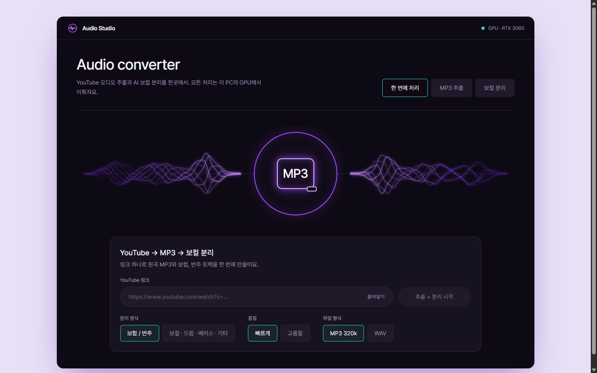
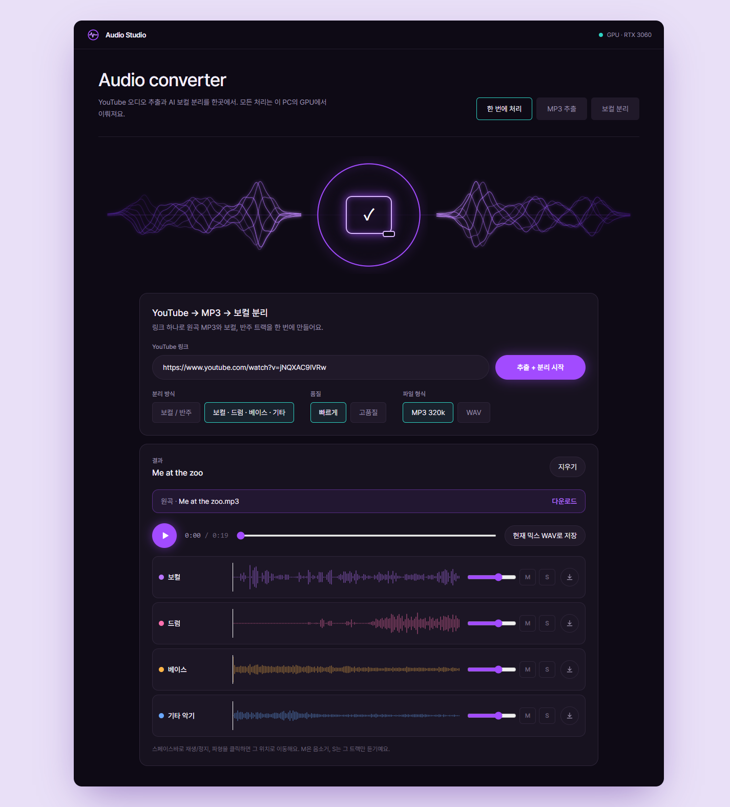
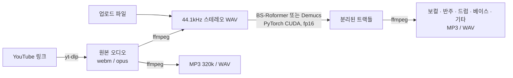

<div align="center">



# Audio Studio

**YouTube 링크 → MP3 추출 → AI 보컬 분리를 한곳에서.**<br />
내 PC의 GPU로 동작하는 로컬 웹앱입니다. 음원을 외부 서버로 보내지 않습니다.


</div>

---

## 주요 기능

| 탭 | 입력 | 결과 |
|---|---|---|
| **한 번에 처리** | YouTube 링크 | 원곡 MP3 + 보컬 / 반주 (또는 4트랙) |
| **MP3 추출** | YouTube 링크 | MP3 320kbps 또는 WAV |
| **보컬 분리** | 내 음원 파일 (MP3, WAV, FLAC, M4A …) | 보컬 / 반주 (또는 4트랙) |

- **분리 방식 2가지**
  - 보컬 / 반주 2트랙: BS-Roformer. 보컬 리무버와 보컬 추출에 사용합니다.
  - 보컬 · 드럼 · 베이스 · 기타 악기 4트랙: Demucs htdemucs_ft.
- **품질 선택**: `빠르게`는 4분 곡을 약 1분에 처리합니다(RTX 3060 기준). `고품질`은 약 2배 느린 대신 결과가 더 매끄럽습니다.
- **트랙 믹서**: 분리 결과를 브라우저에서 바로 들어볼 수 있습니다.
  - 트랙별로 볼륨, 음소거(M), 솔로(S)를 조절할 수 있습니다.
  - 파형을 클릭하면 해당 위치로 이동하고, 스페이스바로 재생과 정지를 합니다.
  - 트랙을 하나씩 받거나, 현재 섞은 상태를 WAV 한 파일로 저장할 수 있습니다.
- **실시간 진행 표시**: 다운로드 → 변환 → 분리 → 저장 단계와 진행률, 예상 시간을 보여줍니다.
- **작업 대기열**: 탭마다 작업이 따로 진행되고, 여러 작업을 넣으면 차례로 처리합니다.

<div align="center">

<br /><sub>4트랙 분리 결과 — 트랙별 파형, 볼륨, 음소거·솔로, 다운로드</sub>
</div>

---

## 처리 흐름



보컬 분리는 MP3가 아니라 **YouTube에서 받은 원본 오디오**로 합니다. 손실 압축을 두 번 거치지 않기 때문에 분리 품질이 더 좋습니다.

---

## 기술 스택

### Backend

| 역할 | 사용 기술 |
|---|---|
| API 서버 | **FastAPI** + Uvicorn |
| YouTube 오디오 추출 | **yt-dlp** (+ yt-dlp-ejs, Node.js 런타임) |
| 오디오 변환 | **ffmpeg** (imageio-ffmpeg 번들, 별도 설치 불필요) |
| 보컬 분리 | **audio-separator** — BS-Roformer-Viperx-1297, Demucs v4 htdemucs_ft |
| 추론 | **PyTorch** (CUDA 12.8, fp16 autocast) |
| 패키지 관리 | **uv** (Python 3.12 가상환경) |

### Frontend

| 역할 | 사용 기술 |
|---|---|
| UI | **React 19** + **TypeScript** + **Vite** |
| 스타일 | **Tailwind CSS 4** (디자인 토큰을 `@theme`로 관리) |
| 오디오 재생 · 믹스 | **Web Audio API** (AudioBufferSourceNode, GainNode, OfflineAudioContext) |
| 파형 | Canvas 2D 직접 렌더링 |
| 진행 상황 수신 | **Server-Sent Events**, 연결이 끊기면 폴링으로 전환 |

---

## 구현 방식

### 1. 작업 큐와 실시간 진행률

- GPU가 하나이므로 작업은 **메모리 큐 + 워커 스레드 1개**로 순서대로 처리합니다. 별도 DB는 사용하지 않습니다.
- 작업 상태가 바뀔 때마다 `version` 값이 올라갑니다. SSE 엔드포인트(`/api/jobs/{id}/events`)는 이 값이 바뀔 때만 새 상태를 보냅니다.
- 진행률은 단계마다 실제 값으로 계산합니다.
  - 다운로드: yt-dlp의 progress hook
  - 변환: ffmpeg의 `-progress` 출력
  - 모델 다운로드: 받은 바이트 수
- 분리 단계는 진행률을 직접 알 수 없습니다. 그래서 막대는 계속 움직이게 두고, 측정한 처리 속도로 **예상 소요 시간**을 보여줍니다.
- 결과 파일은 `%LOCALAPPDATA%\AudioStudio\jobs`에 저장되며, 24시간 뒤 자동으로 삭제됩니다.

### 2. 분리 속도 튜닝 (RTX 3060, 60초 음원 기준)

audio-separator의 기본 설정은 fp32 연산에 overlap 4입니다. 여기서 두 가지를 바꿔 약 4배 빨라졌습니다.

- **fp16 autocast**를 켰습니다. 3060(Ampere)에는 fp16 연산을 빠르게 처리하는 텐서 코어가 있습니다.
- 구간을 겹쳐 계산하는 정도(**overlap**)를 품질 옵션에 따라 조절합니다.

| 설정 | 처리 시간 | 속도 |
|---|---|---|
| 기본값 (fp32, overlap 4) | 62초 | 0.97× 실시간 |
| fp16 + overlap 4 (`고품질`) | 30초 | 2.0× |
| fp16 + overlap 2 (`빠르게`) | 16초 | 3.8× |

모델은 한 번 불러오면 메모리에 계속 유지합니다. 품질 옵션을 바꿔도 모델을 다시 불러오지 않고, 이미 올라간 모델의 설정값(`overlap`, `shifts`)만 변경합니다.

### 3. 모델 다운로드: 미러 + 체크섬 검증

audio-separator는 모델을 GitHub Release에서 받는데, 네트워크 환경에 따라 504 오류가 계속 발생하기도 합니다. 그래서 `backend/app/models.py`가 필요한 파일을 미리 받아 둡니다.

1. HuggingFace 미러를 먼저 시도하고, 실패하면 원래 GitHub 주소로 넘어갑니다.
2. 받은 파일은 **audio-separator에 포함된 공식 SHA-256**과 비교하고, 다르면 버린 뒤 다음 주소를 시도합니다.
3. 파일이 이미 있으면 audio-separator는 다운로드를 건너뛰고 바로 모델을 불러옵니다.

### 4. 브라우저 믹서

- 분리된 트랙을 `AudioBuffer`로 디코딩합니다.
- 트랙마다 `GainNode`를 연결하고, 모든 트랙을 같은 시각에 `start()`해서 싱크를 맞춥니다.
- 솔로 트랙이 하나라도 있으면 솔로 트랙만 들리게 하고, 없으면 음소거와 볼륨 설정을 그대로 따릅니다.
- "현재 믹스 저장"은 `OfflineAudioContext`로 같은 그래프를 빠르게 렌더링한 뒤 16-bit WAV로 변환해 다운로드합니다.

### 5. 분리 엔진 인터페이스 (공개 버전 대비)

```ts
// frontend/src/separator/types.ts
interface SeparatorEngine {
  readonly id: 'server' | 'browser'
  readonly modes: SplitMode[]
  separate(file: File, opts: SeparationOptions, onUpdate: (job: Job) => void, signal?: AbortSignal): Promise<Job>
}
```

현재는 로컬 GPU 서버를 사용하는 `server` 엔진만 있습니다. 이후 보컬 분리만 공개할 때 ONNX Runtime Web + WebGPU로 동작하는 `browser` 엔진을 추가하면 됩니다. 화면 코드는 바꾸지 않고, 서버 GPU 비용 없이 정적 사이트로 배포할 수 있습니다.

---

## 시작하기

### 요구 사항

- Windows 10/11
- [uv](https://docs.astral.sh/uv/): `winget install astral-sh.uv`
- [Node.js](https://nodejs.org/) 20 이상
- NVIDIA GPU 권장. 없으면 CPU로 동작하지만 많이 느립니다.

### 실행

```bat
start.bat
```

처음 실행하면 Python 패키지(PyTorch 포함, 수 GB)를 설치하고 화면을 빌드한 뒤 서버를 띄웁니다. 서버가 뜨면 **http://127.0.0.1:8000** 이 자동으로 열립니다.

```bat
start.bat -Dev   :: 개발 모드 — 백엔드 자동 재시작 + Vite 핫리로드 (http://localhost:5173)
```

> 분리 모델은 **처음 분리할 때 한 번** 내려받습니다. 보컬/반주 모델은 639MB, 4트랙 모델은 337MB입니다.
> 가상환경, 모델, 결과 파일은 `%LOCALAPPDATA%\AudioStudio`에 저장됩니다. 프로젝트 폴더를 OneDrive 같은 동기화 폴더에 두어도 큰 파일은 업로드되지 않습니다.

---

## 프로젝트 구조

```
audio-studio/
├─ start.bat / start.ps1        실행 스크립트
├─ backend/
│  ├─ pyproject.toml            의존성 (PyTorch CUDA 인덱스 포함)
│  └─ app/
│     ├─ main.py                REST API · SSE · 파일 제공 · 빌드된 프론트 서빙
│     ├─ pipeline.py            다운로드 → 변환 → 분리 → 인코딩
│     ├─ jobs.py                작업 큐, 진행 상태, 자동 정리
│     ├─ models.py              모델 미러 다운로드 + 체크섬 검증
│     └─ config.py              경로, 모델, ffmpeg 위치
└─ frontend/
   └─ src/
      ├─ App.tsx                탭, 레이아웃, 결과 화면
      ├─ components/
      │  ├─ Hero.tsx            네온 파형 + 진행 링 비주얼
      │  ├─ YoutubeForm.tsx     링크 입력 (한 번에 처리 / MP3 추출)
      │  ├─ UploadForm.tsx      파일 업로드 (보컬 분리)
      │  ├─ JobProgress.tsx     단계별 진행 표시
      │  └─ StemMixer.tsx       트랙 믹서 (Web Audio)
      ├─ separator/             분리 엔진 인터페이스 (server / browser)
      └─ lib/                   API 클라이언트, 오디오 유틸, 타입
```

## API

| Method | Path | 설명 |
|---|---|---|
| `GET` | `/api/health` | 서버 상태와 GPU 이름 |
| `POST` | `/api/jobs/youtube` | `{ url, separate, mode, format, quality }`로 작업 생성 |
| `POST` | `/api/jobs/upload` | multipart: `file`, `mode`, `format`, `quality` |
| `GET` | `/api/jobs/{id}` | 작업 상태 조회 |
| `GET` | `/api/jobs/{id}/events` | 작업 상태 SSE 스트림 |
| `GET` | `/api/files/{id}/{name}` | 결과 파일 (`?download=true`면 다운로드) |

---

## 로드맵

- [ ] 브라우저 분리 엔진(ONNX Runtime Web + WebGPU)으로 **보컬 분리만 공개 배포**
- [ ] 노래방용 모델(리드 보컬만 제거, 백보컬 유지) 옵션
- [ ] 작업 기록 보기

## 주의 사항

이 프로젝트는 **개인 학습과 개인 소장 용도**로 만들었습니다. YouTube 콘텐츠를 내려받는 것은 [YouTube 서비스 약관](https://www.youtube.com/t/terms)에 위배될 수 있습니다. 저작권이 있는 음원은 권리자의 허락 없이 배포하거나 상업적으로 이용할 수 없습니다. 사용에 따른 책임은 사용자에게 있습니다.

## 감사의 말

- [yt-dlp](https://github.com/yt-dlp/yt-dlp)
- [python-audio-separator](https://github.com/nomadkaraoke/python-audio-separator)
- [Demucs](https://github.com/facebookresearch/demucs) — Meta AI
- BS-Roformer 모델: [UVR](https://github.com/Anjok07/ultimatevocalremovergui) 커뮤니티 (viperx, ZFTurbo)
